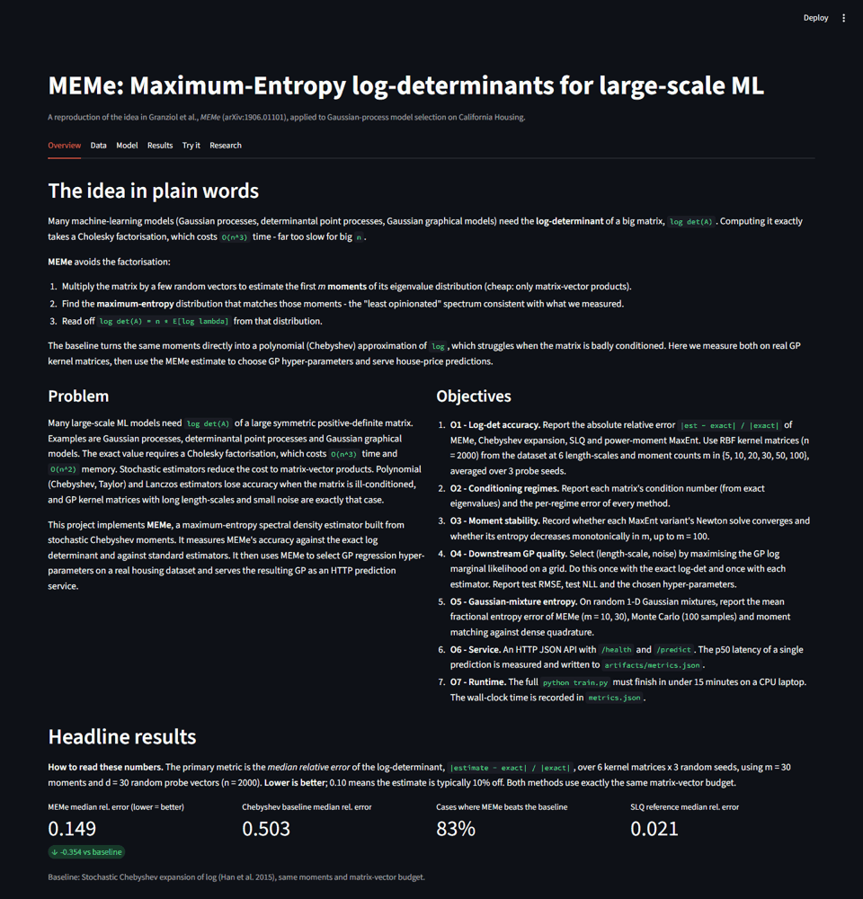
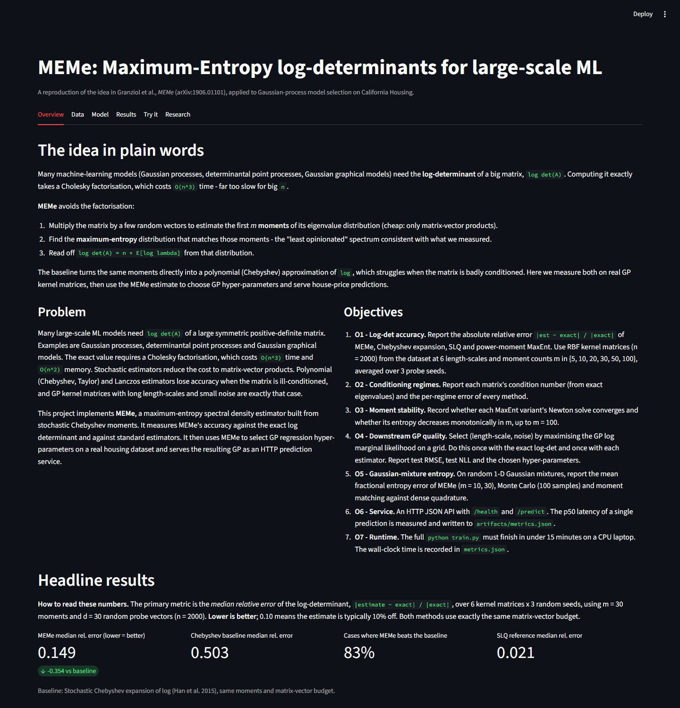
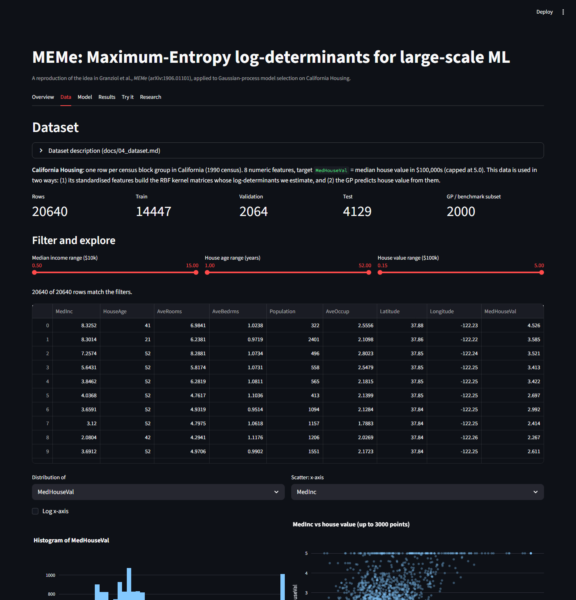
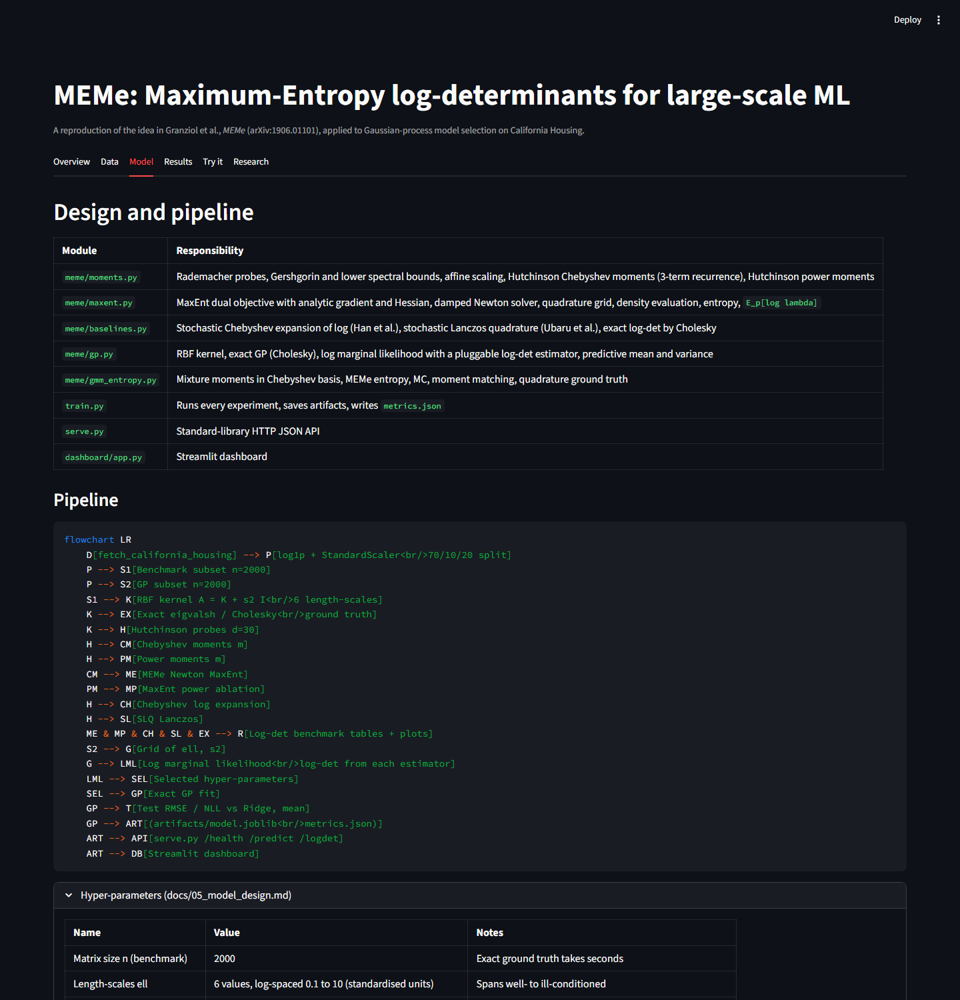
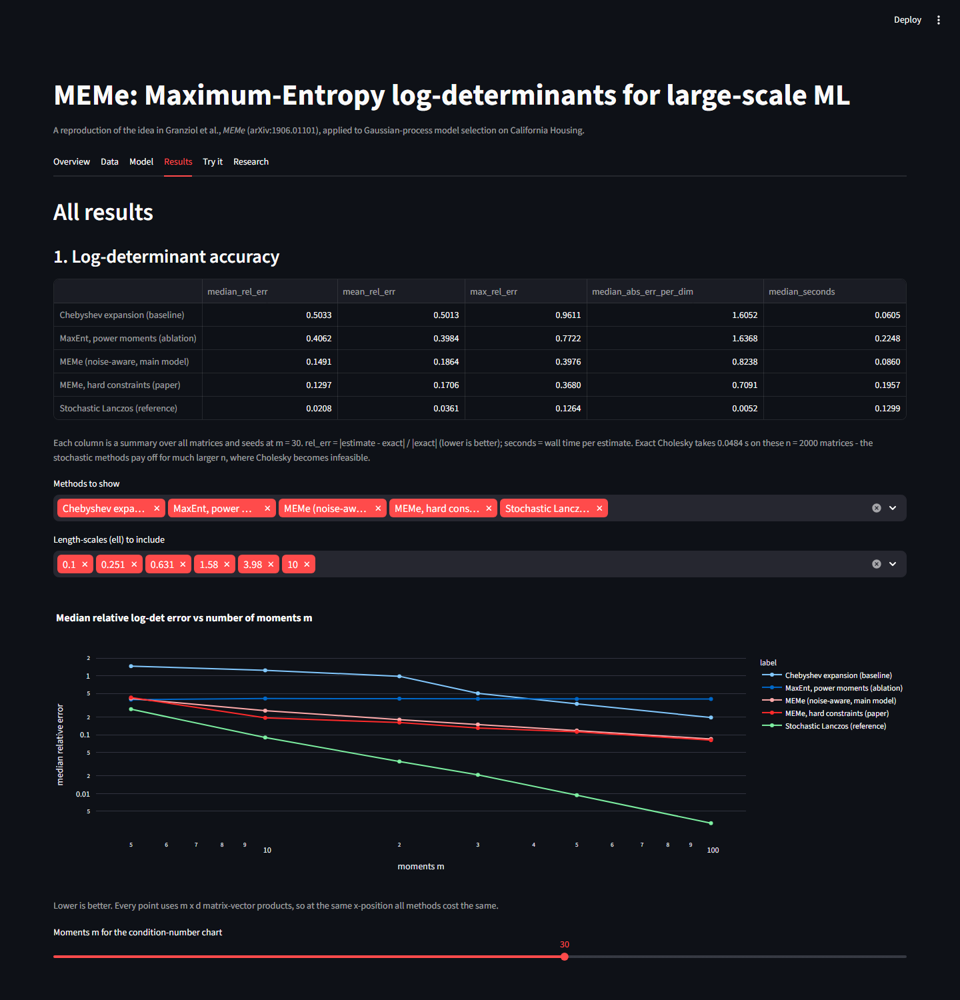
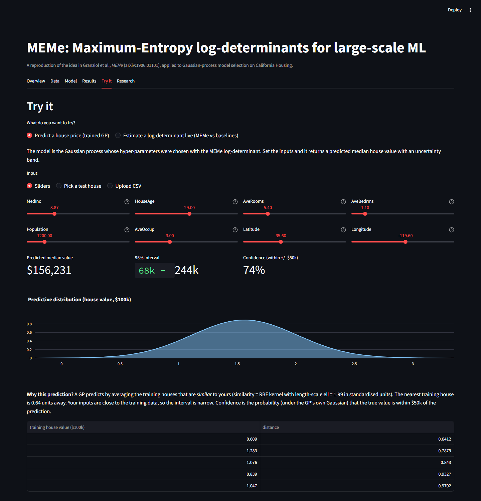
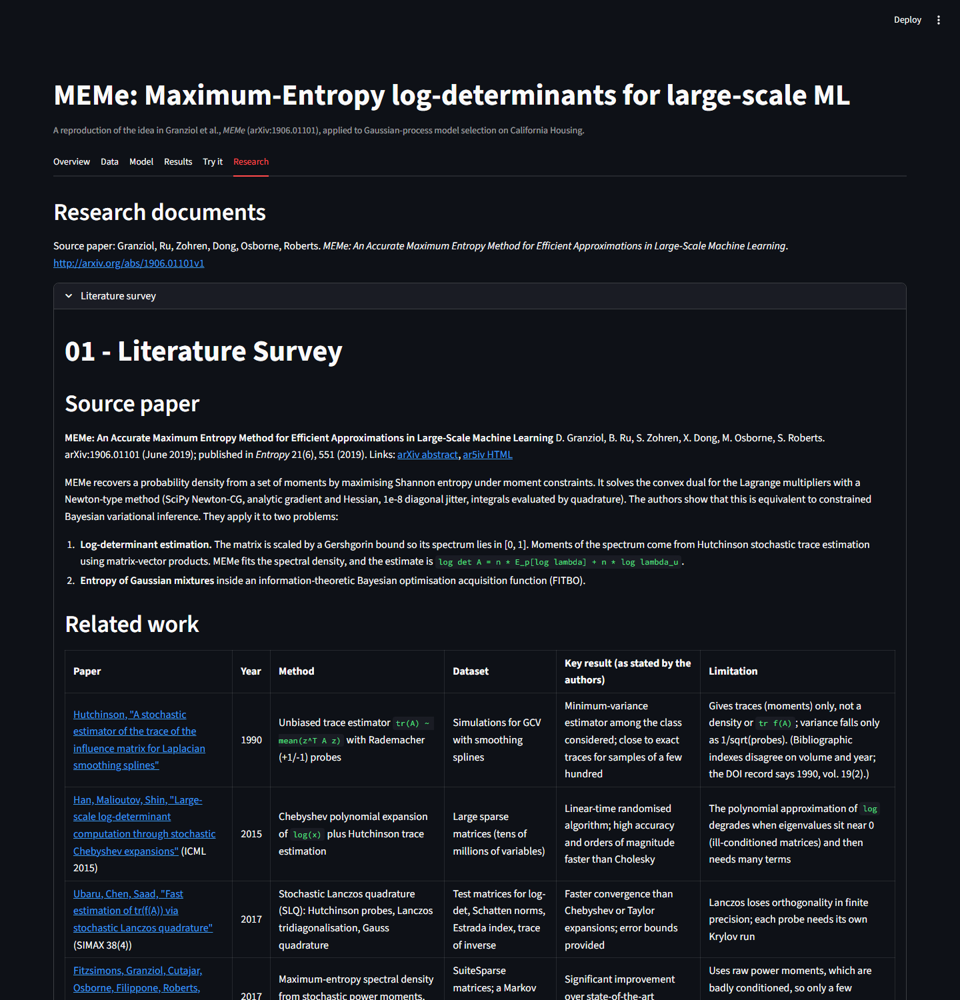
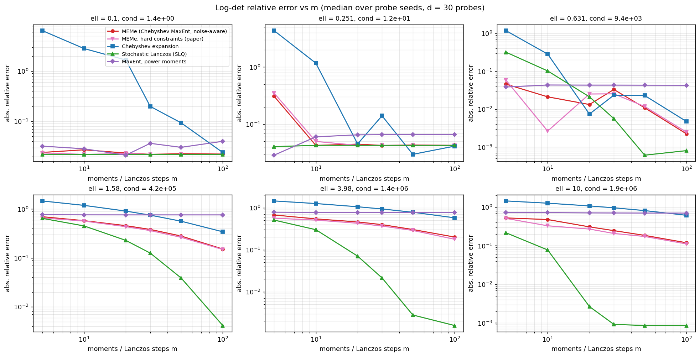
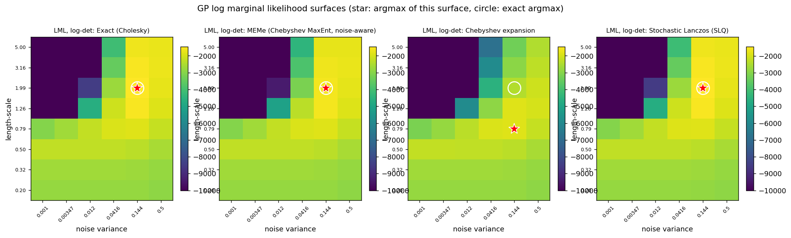
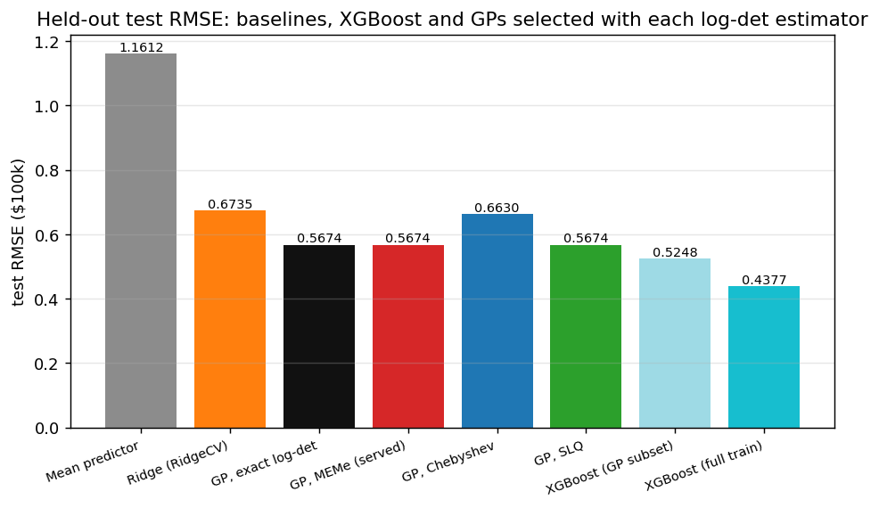

# MEMe: Maximum-Entropy Log-Determinants for Gaussian-Process Model Selection

**Live dashboard:** [https://meme-an-accurate-maximum-entropy-me.vercel.app](https://meme-an-accurate-maximum-entropy-me.vercel.app) - the full interactive dashboard (all tabs, live predictions) running in your browser; nothing to install. The first visit takes about a minute to load.


This project re-implements **MEMe** (Granziol et al., 2019). MEMe estimates `log det(A)` of a large
matrix from the *maximum-entropy spectral density* that matches a set of stochastic Chebyshev
moments, using only matrix-vector products. We benchmark it against the stochastic Chebyshev
expansion, stochastic Lanczos quadrature (SLQ), power-moment MaxEnt and exact Cholesky. The test
matrices are RBF kernel matrices built from the California Housing dataset, with condition numbers
from 1.4 to 1.9e6. We then use each estimator inside the GP marginal likelihood to choose
hyper-parameters, and serve the resulting house-price GP. An interactive Streamlit dashboard
explains and explores every result.

## Dashboard preview

Screenshots of the interactive dashboard (`streamlit run app.py`), captured automatically from the running app.



<details><summary>Every tab as a still image</summary>

**Overview**



**Data**



**Model**



**Results**



**Try It**



**Research**



</details>

## Results at a glance

These are from `artifacts/metrics.json` for a full run on a CPU laptop (141.7 s).

| Log-det estimator (m = 30 moments, d = 30 probes, n = 2000) | Median relative error (lower is better) |
|---|---|
| **MEMe (noise-aware Chebyshev MaxEnt) - this project** | **0.149** |
| Stochastic Chebyshev expansion (Han et al.) - baseline | 0.503 |
| MaxEnt with power moments - ablation | 0.406 |
| Stochastic Lanczos quadrature - strong reference | 0.021 |

| Downstream: GP chosen with each log-det | Selected (ell, noise) | Test RMSE ($100k) |
|---|---|---|
| **MEMe** | (1.993, 0.144) - same as exact | **0.567** |
| Exact Cholesky | (1.993, 0.144) | 0.567 |
| Chebyshev expansion | (0.795, 0.144) | 0.663 |
| Ridge regression | - | 0.674 |

- MEMe is **3.4 times more accurate** than the Chebyshev expansion at the same budget, and wins 83.3 %
  of cases.
- MEMe picks **exactly the same GP hyper-parameters as the exact log-det**.
- SLQ is more accurate than MEMe in our setting, and XGBoost (test RMSE 0.438) is a better house-price
  predictor than the GP. See [Limitations](#limitations).





## What you get

The dashboard (`streamlit run app.py`) has six tabs:

| Tab | What it shows |
|---|---|
| **Overview** | The idea in plain words, headline metrics, and the automatic checks written by `train.py` |
| **Data** | Dataset explorer with filters, a map of the houses, feature correlations, and the conditioning of the benchmark matrices |
| **Model** | Pipeline diagram, the hyper-parameters actually used, Newton convergence curves, and the XGBoost search |
| **Results** | Interactive log-det benchmark, estimated vs true spectrum, GP selection surfaces, GMM entropy, error analysis, and all saved figures |
| **Try it** | Predict a house price with uncertainty (sliders, a test row, or CSV upload), or build a kernel matrix live and compare MEMe with every baseline |
| **Research** | The literature survey, problem definition, strategy, dataset, model design and results documents |

## Quickstart

1. `git clone https://github.com/evanchoudhury/meme-an-accurate-maximum-entropy-method-for-effici-9892b5.git`
2. `cd meme-an-accurate-maximum-entropy-method-for-effici-9892b5`
3. Create and activate a virtual environment:
   `python -m venv .venv`, then `.venv\Scripts\activate` (Windows) or `source .venv/bin/activate`
   (macOS/Linux)
4. `pip install -r requirements.txt`
5. `python train.py`. This downloads the dataset on the first run and takes about 2-3 minutes on a
   CPU. Use `python train.py --quick` for a smoke run.
6. `streamlit run app.py`, which opens http://localhost:8501

Trained artifacts are already committed in `artifacts/`, so step 6 also works without step 5.

Checks: `python selfcheck.py` (unit-style checks on synthetic data) and
`python tests/check_dashboard.py` (renders every dashboard tab headlessly).

## Run with Docker

```bash
docker compose up --build
```

Then open http://localhost:8501.

## Run on Kubernetes

```bash
docker build -t meme-dashboard:latest .
# make the image available to your cluster (for example: kind load docker-image meme-dashboard:latest)
kubectl apply -f k8s/deployment.yaml
kubectl apply -f k8s/service.yaml
kubectl port-forward service/meme-dashboard 8501:8501
```

Then open http://localhost:8501. The pod requests 250m CPU and 512Mi of memory, with limits of
1 CPU and 1Gi.

## Project structure

```
app.py                  Streamlit dashboard
train.py                Runs every experiment, writes artifacts/
selfcheck.py            Fast correctness checks
src/
  data.py               Dataset download/cache, preprocessing, splits
  moments.py            Rademacher probes, spectral bounds, Chebyshev/power moments
  maxent.py             MaxEnt dual, Newton solver, quadrature, log-det read-out
  baselines.py          Chebyshev expansion, SLQ, exact Cholesky
  gp.py                 RBF kernel, exact GP, log marginal likelihood
  model.py              Estimator dispatch, GP grid search, served model
  gmm_entropy.py        Gaussian-mixture entropy experiment
  evaluate.py           Metrics and plots
tests/check_dashboard.py
artifacts/              metrics.json, CSVs, model.joblib, plots/
docs/                   Project documentation (see below)
research_paper/paper.md IEEE-style write-up
Dockerfile, docker-compose.yml, k8s/
```

## Documentation

- [01 - Literature survey](docs/01_literature_survey.md)
- [02 - Problem definition](docs/02_problem_definition.md)
- [03 - Solution strategy](docs/03_solution_strategy.md)
- [04 - Dataset](docs/04_dataset.md)
- [05 - Model design](docs/05_model_design.md)
- [06 - Results](docs/06_results.md)
- [Research paper (IEEE style)](research_paper/paper.md)

## Source paper

D. Granziol, B. Ru, S. Zohren, X. Dong, M. Osborne, and S. Roberts, "MEMe: An Accurate Maximum
Entropy Method for Efficient Approximations in Large-Scale Machine Learning," *Entropy* 21(6), 551,
2019. [arXiv:1906.01101](http://arxiv.org/abs/1906.01101v1)

## Limitations

- **SLQ beats MEMe** here: median error 0.021 vs 0.149, and SLQ wins 83.3 % of cases, most clearly on
  ill-conditioned matrices. Our maximum condition number (1.9e6) is far below the about 1e9 regime
  where the paper reports MEMe ahead.
- **No speed-up is shown.** At n = 2000 with dense matrices, exact Cholesky (0.050 s) is faster than
  the stochastic estimators.
- **Main model differs from the paper.** It uses soft (noise-aware) moment constraints. The paper's
  hard-constraint version converged in 0 % of solves at m >= 30, but was slightly more accurate
  (0.130).
- **Small benchmark.** 6 matrices and 3 probe seeds per setting, with no confidence intervals.
- **The GP is not the best predictor.** It uses exact inference on a 2000-row subset, and its 95 %
  intervals cover 92.1 % of test points.

## License

MIT. See [LICENSE](LICENSE).
