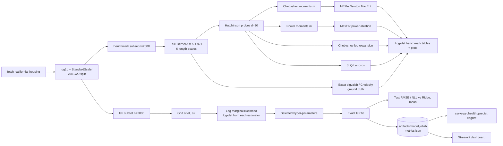

# 05 - Model Design

## Components

| Module | Responsibility |
|---|---|
| `meme/moments.py` | Rademacher probes, Gershgorin and lower spectral bounds, affine scaling, Hutchinson Chebyshev moments (3-term recurrence), Hutchinson power moments |
| `meme/maxent.py` | MaxEnt dual objective with analytic gradient and Hessian, damped Newton solver, quadrature grid, density evaluation, entropy, `E_p[log lambda]` |
| `meme/baselines.py` | Stochastic Chebyshev expansion of log (Han et al.), stochastic Lanczos quadrature (Ubaru et al.), exact log-det by Cholesky |
| `meme/gp.py` | RBF kernel, exact GP (Cholesky), log marginal likelihood with a pluggable log-det estimator, predictive mean and variance |
| `meme/gmm_entropy.py` | Mixture moments in Chebyshev basis, MEMe entropy, MC, moment matching, quadrature ground truth |
| `train.py` | Runs every experiment, saves artifacts, writes `metrics.json` |
| `serve.py` | Standard-library HTTP JSON API |
| `dashboard/app.py` | Streamlit dashboard |

## Pipeline diagram

## Hyper-parameters

| Name | Value | Notes |
|---|---|---|
| Matrix size n (benchmark) | 2000 | Exact ground truth takes seconds |
| Length-scales ell | 6 values, log-spaced 0.1 to 10 (standardised units) | Spans well- to ill-conditioned |
| Noise sigma^2 (benchmark) | 1e-3 | Combined with a large ell, gives a high condition number |
| Signal variance | 1.0 | |
| Moments m | 5, 10, 20, 30, 50, 100 | Tests the "hundreds of moments" claim up to 100 |
| Probes d | 30 Rademacher | Same probes for all methods per seed |
| Seeds | 3 | |
| Newton tolerance | gradient max-norm < 1e-8, at most 200 iterations | |
| Hessian jitter | 1e-8 | As in the paper |
| Quadrature | Graded grid on [-1, 1], about 4000 nodes, plus trapezoid | Refinement toward -1 |
| GP grid | ell: 8 values in [0.2, 5]; sigma^2: 6 values in [1e-3, 0.5] | 48 LML evaluations per estimator |
| GP estimator settings | m = 30, d = 30 | Primary configuration |
| Ridge alpha | chosen by `RidgeCV` over [1e-3 ... 1e3] | Baseline |

## Change made during implementation (phase 2)

Hutchinson moments are noisy, and a noisy moment vector often cannot be matched by any
positive density. With hard moment constraints, the Newton solve then never converges. In
the full run, 0 % of the hard-constraint solves converged at m = 30. The main MEMe model
therefore treats each moment k >= 1 as a soft constraint. Its noise level is the measured
standard error across the d probes. This adds `0.5 * sum_k s_k^2 alpha_k^2` to the dual,
which acts as a Gaussian prior on the multipliers. The dual becomes strongly convex and
every solve converges. The paper's original hard-constraint MEMe is kept as the ablation
`meme_hard` and reported next to it. Code lives in `src/` (not `meme/`). An XGBoost
regressor (tuned on the validation split) is also trained and reported as an extra
predictive baseline.

## Baseline models

- **Log-det estimators:** the stochastic Chebyshev expansion (**primary baseline**), SLQ (strong
  reference), power-moment MaxEnt (ablation), and the exact value (ground truth).
- **Predictive models:** a mean predictor (constant train mean), Ridge regression on the same features,
  and an exact GP whose hyper-parameters were selected with the *exact* log-det (oracle reference).

## Evaluation protocol

1. **Log-det accuracy.** For every (ell, m, seed, method): absolute relative error, signed error and wall
   time. Aggregate by median and mean over seeds. Summarise by condition-number regime. The primary
   metric is the median error at m = 30, MEMe vs Chebyshev.
2. **Stability.** Newton convergence flag, number of iterations, and entropy as a function of m. A
   monotone decrease in entropy is expected when moments are consistent.
3. **Spectral fidelity.** Plot MEMe densities against histograms of the exact eigenvalues for selected ell.
4. **Downstream.** Compare the hyper-parameters chosen by each estimator with the exact choice. Report
   test RMSE, MAE, R^2 and Gaussian NLL of the resulting GPs, plus the baselines. Validation RMSE is
   also reported.
5. **GMM entropy.** Mean fractional error `|H_est - H_true| / |H_true|` over 50 random mixtures.
6. **Service.** p50 and p95 latency of `/predict`, measured in-process on 200 requests.
7. Every number goes into `artifacts/metrics.json` and the CSVs. Documentation and the dashboard read
   from these files only.
