# 06 - Results

Every number in this document comes from `artifacts/metrics.json` (full run, `quick_mode: false`)
or from `artifacts/sample_predictions.csv` (300 test rows), both written by `python train.py`.
Values are rounded for display only. The full run took 141.7 s on a CPU laptop: 99.1 s for the log-det
benchmark, 23.7 s for the GP grid, 5.8 s for XGBoost and 5.0 s for the GMM entropy experiment.

**Setup in one paragraph.** We use California Housing (14,447 train / 2,064 validation / 4,129 test
rows). We build RBF kernel matrices `A = K + 1e-3 I` with n = 2000 on a fixed training subset, for 6
length-scales from 0.1 to 10. Their condition numbers run from 1.36 to 1.87e6. Each log-det estimator
gets the same budget: m moments (or Lanczos steps) with d = 30 Rademacher probes, over 3 probe seeds.
Exact Cholesky gives the ground truth. The primary metric is the **median absolute relative log-det
error at m = 30, d = 30** (lower is better).

## 1. Primary result: log-determinant accuracy

| Method (m = 30, d = 30) | Median rel. error | Mean rel. error | Max rel. error | Median abs. error per dim | Median seconds |
|---|---|---|---|---|---|
| **MEMe (Chebyshev MaxEnt, noise-aware) - main model** | **0.149** | 0.186 | 0.398 | 0.824 | 0.088 |
| Stochastic Chebyshev expansion (Han et al.) - **primary baseline** | 0.503 | 0.501 | 0.961 | 1.605 | 0.062 |
| MEMe, hard constraints (as in the paper) - ablation | 0.130 | 0.171 | 0.368 | 0.709 | 0.205 |
| MaxEnt with power moments (Fitzsimons et al.) - ablation | 0.406 | 0.398 | 0.772 | 1.637 | 0.240 |
| Stochastic Lanczos quadrature (SLQ) - strong reference | 0.021 | 0.036 | 0.126 | 0.0052 | 0.127 |
| Exact Cholesky (ground truth) | 0 | 0 | 0 | 0 | 0.050 |

**MEMe's median relative error (0.149) is about 3.4 times lower than the Chebyshev expansion's
(0.503) at the same matrix-vector budget.** MEMe beats Chebyshev in 83.3 % of the
(length-scale, seed) cases and power-moment MaxEnt in 88.9 % of them. **SLQ is clearly the most
accurate estimator in our setup.** MEMe beats SLQ in only 16.7 % of cases (check
`meme_beats_slq_logdet = false`).

### Error as a function of the number of moments

Median relative error over all 6 matrices and 3 seeds:

| m | MEMe | MEMe (hard) | Chebyshev | MaxEnt power | SLQ |
|---|---|---|---|---|---|
| 5 | 0.411 | 0.429 | 1.457 | 0.394 | 0.270 |
| 10 | 0.255 | 0.193 | 1.239 | 0.410 | 0.090 |
| 20 | 0.180 | 0.161 | 0.982 | 0.408 | 0.035 |
| 30 | 0.149 | 0.130 | 0.503 | 0.406 | 0.021 |
| 50 | 0.118 | 0.112 | 0.333 | 0.405 | 0.0094 |
| 100 | 0.085 | 0.081 | 0.196 | 0.404 | 0.0031 |

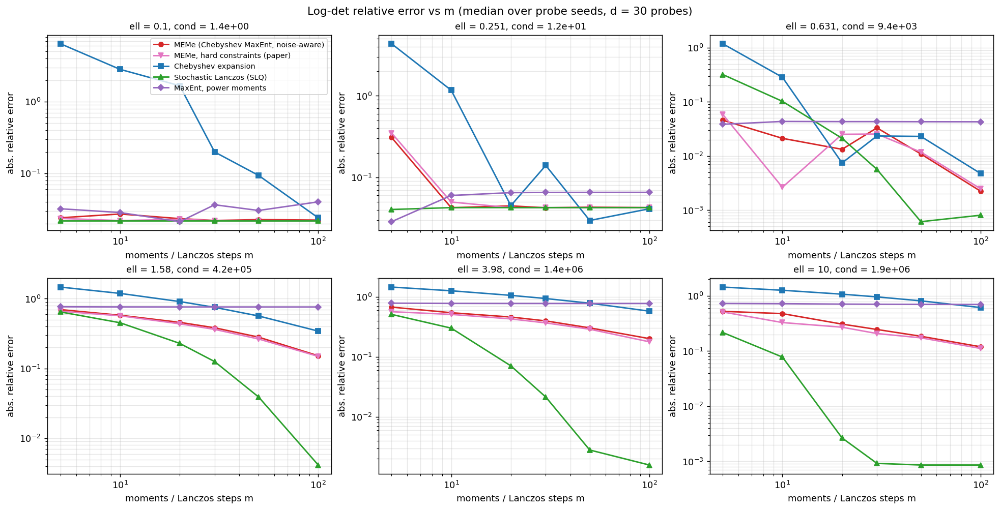

*Interpretation.* MEMe's error falls steadily as m grows, from 0.411 at m = 5 to 0.085 at m = 100. It
keeps using extra Chebyshev moments, which supports the paper's claim that orthogonal moments stay
usable at high m. Power-moment MaxEnt stays flat at about 0.40 whatever m is, so the extra power
moments add no information it can use. This is the conditioning problem that MEMe was designed to
fix. On the two well-conditioned matrices (ell = 0.1 and 0.251), MEMe, power MaxEnt and SLQ reach
about the same error, and the Chebyshev expansion needs m = 50-100 to catch up. On the three
ill-conditioned matrices (bottom row), SLQ converges much faster than every moment-based method.

### Error as a function of conditioning (m = 30)

| ell | Condition number | Exact log-det | MEMe | MEMe (hard) | Chebyshev | MaxEnt power | SLQ |
|---|---|---|---|---|---|---|---|
| 0.1 | 1.36 | 1.94 | 0.022 | 0.022 | 0.199 | 0.036 | 0.022 |
| 0.251 | 12.1 | -29.07 | 0.042 | 0.043 | 0.140 | 0.065 | 0.043 |
| 0.631 | 9.40e3 | -1503.1 | 0.033 | 0.026 | 0.023 | 0.043 | 0.0057 |
| 1.58 | 4.18e5 | -8518.2 | 0.383 | 0.363 | 0.751 | 0.760 | 0.126 |
| 3.98 | 1.38e6 | -12619.2 | 0.396 | 0.367 | 0.934 | 0.772 | 0.021 |
| 10 | 1.87e6 | -13489.6 | 0.247 | 0.208 | 0.961 | 0.707 | 0.00092 |

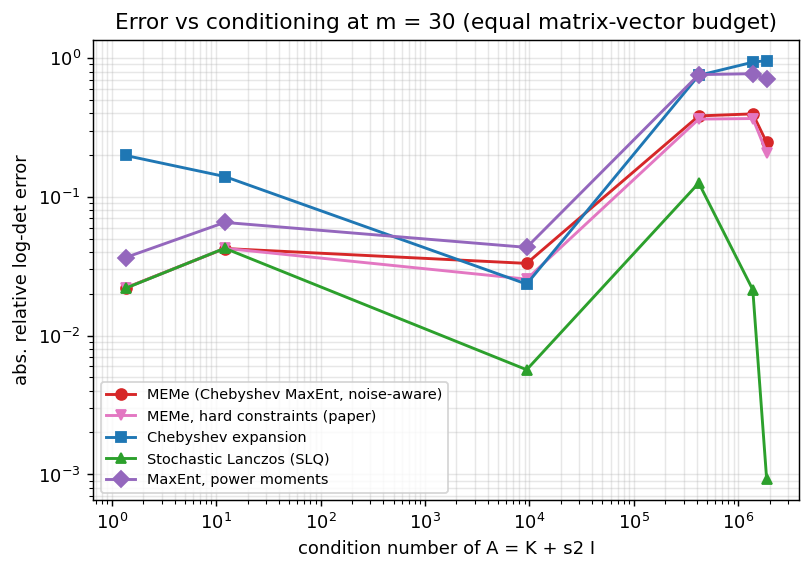

*Interpretation.* All estimators do well when the condition number is small. Once it passes about
1e5, the Chebyshev expansion and power MaxEnt both fail, with relative errors from 0.71 to 0.96. MEMe
degrades less, to between 0.25 and 0.40. SLQ stays accurate, with errors between 0.0009 and 0.126.
Note that at ell = 0.1 the exact log-det is close to zero (1.94). A *relative* error there is a
small absolute error divided by a small number, so these cells exaggerate the differences between
methods.

## 2. Why MEMe has trouble with ill-conditioned matrices: the spectrum it recovers

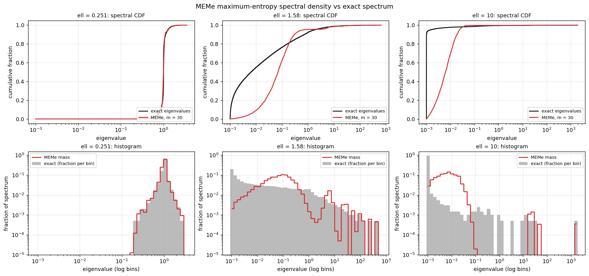

*Interpretation.* For ell = 0.251, the MEMe density (m = 30) matches the exact eigenvalue CDF almost
exactly. For ell = 1.58 and ell = 10, most eigenvalues sit in a very sharp spike at the noise floor
(1e-3). The smooth MaxEnt density spreads that mass over roughly 1e-3 to 1e-1 instead. It therefore
overestimates the typical `log(lambda)`, which explains the 0.25-0.40 relative errors in the table
above. With 30 polynomial moments on a spectrum that spans six orders of magnitude, MEMe cannot
resolve a spike this narrow. The Gauss quadrature nodes in SLQ can place themselves right at such a
spike.

## 3. Optimisation stability (the paper's robustness claim)

| m | MEMe converged | MEMe (hard) converged | MaxEnt power converged | MEMe median Newton iterations |
|---|---|---|---|---|
| 5 | 100 % | 55.6 % | 100 % | 51.5 |
| 10 | 100 % | 33.3 % | 50.0 % | 70 |
| 20 | 100 % | 16.7 % | 33.3 % | 99.5 |
| 30 | 100 % | 0 % | 33.3 % | 94 |
| 50 | 100 % | 0 % | 33.3 % | 116.5 |
| 100 | 100 % | 0 % | 16.7 % | 146 |

"Converged" means the gradient max-norm fell below 1e-8. Entropy decreased monotonically in m in
100 % of cases for both MEMe variants and in 88.9 % of cases for power MaxEnt.

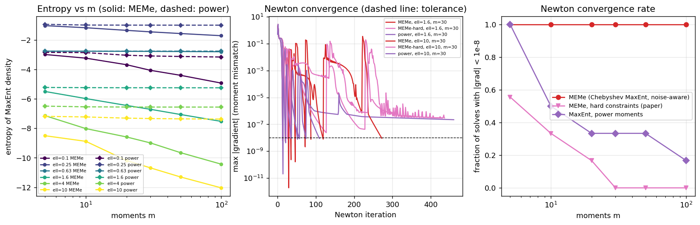

*Interpretation.* Hutchinson moments are noisy, and a noisy moment vector often cannot be matched
exactly by any positive density. With the paper's hard constraints, Newton therefore never reaches the
tolerance at m >= 30 (0 % converged). The noise-aware variant uses soft constraints weighted by the
measured standard error of each moment. It converged in every solve. Its accuracy is close to the
hard-constraint version: median 0.149 vs 0.130 at m = 30, and the hard version wins 83.3 % of
head-to-head cases. It also ran faster (0.088 s vs 0.205 s), because Newton stops instead of running
to the iteration cap. We chose the noise-aware variant as the main model for its robustness. The
hard-constraint version is reported as an honest ablation, and is slightly more accurate here.

## 4. Wall time

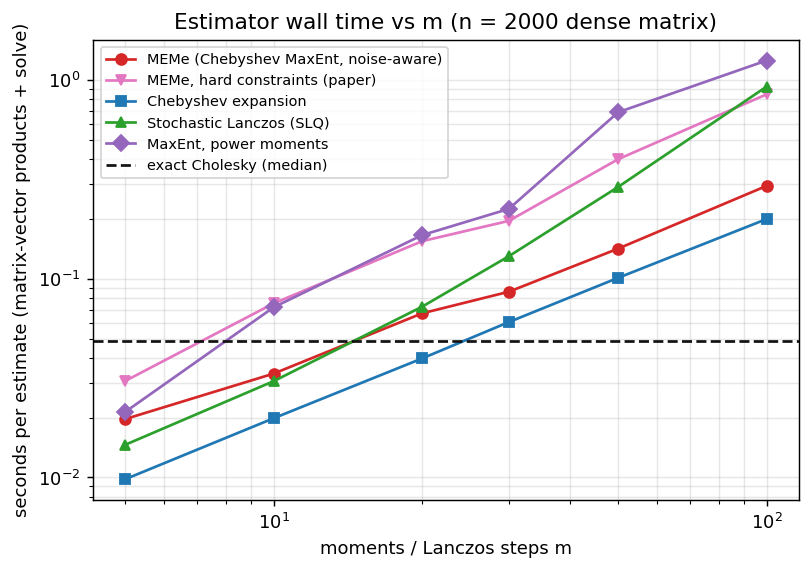

*Interpretation.* At n = 2000, the dense matrix-vector products dominate, and exact Cholesky (median
0.050 s) is faster than every stochastic estimator from m of about 20 upward. The stochastic methods
only pay off for much larger or sparse matrices, where the cubic Cholesky cost dominates. We do not
test that regime here (see Limitations). Among the stochastic methods, MEMe is the cheapest after the
plain Chebyshev expansion: its Newton solve costs little next to the products.

## 5. Downstream: GP hyper-parameters chosen with each log-det

We searched an 8 x 6 grid (ell in [0.2, 5], noise variance in [1e-3, 0.5]) on a 2000-row training
subset. The data-fit term is exact, so the four LML surfaces differ only through the log-det.

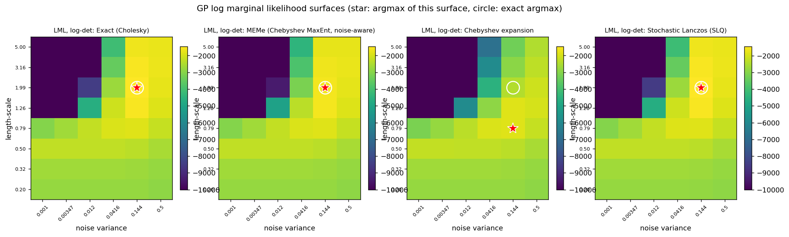

| Log-det used for selection | Selected ell | Selected noise | Same as exact? | Grid log-det median rel. err | Grid log-det time (s) |
|---|---|---|---|---|---|
| Exact (Cholesky) | 1.993 | 0.144 | - | 0 | 6.33 (full GP fit) |
| **MEMe** | 1.993 | 0.144 | **yes** | 0.052 | 4.99 (incl. moments) |
| Chebyshev expansion | 0.795 | 0.144 | no | 0.347 | 0.0022 (reuses MEMe's moments) |
| SLQ | 1.993 | 0.144 | yes | 0.013 | 8.41 |

Test-set results (4,129 rows; target in units of $100k):

| Model | RMSE | MAE | R^2 | Gaussian NLL | 95 % coverage |
|---|---|---|---|---|---|
| **GP, hyper-parameters chosen with MEMe (served model)** | **0.567** | 0.397 | 0.761 | 0.836 | 92.1 % |
| GP chosen with exact log-det (oracle) | 0.567 | 0.397 | 0.761 | 0.836 | 92.1 % |
| GP chosen with SLQ | 0.567 | 0.397 | 0.761 | 0.836 | 92.1 % |
| GP chosen with Chebyshev expansion (baseline) | 0.663 | 0.466 | 0.674 | 0.963 | 96.1 % |
| Ridge regression (alpha = 3.16) | 0.674 | 0.488 | 0.663 | 1.024 | 94.3 % |
| Mean predictor | 1.161 | 0.917 | -0.0003 | 1.568 | 92.8 % |
| XGBoost on the same 2000-row subset | 0.525 | 0.358 | 0.796 | 0.775 | 94.0 % |
| XGBoost on all 14,447 train rows | **0.438** | 0.284 | 0.858 | 0.593 | 94.2 % |

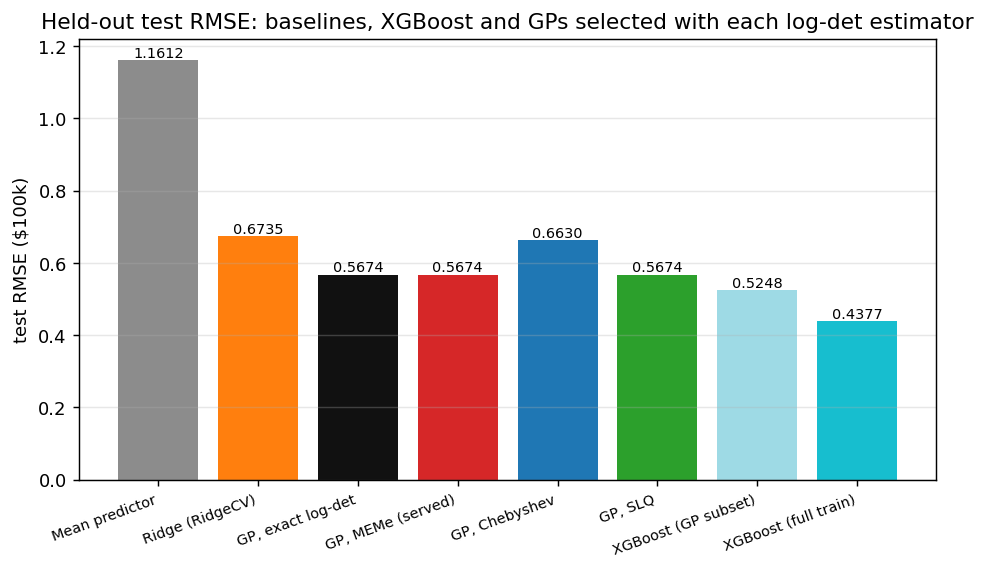

*Interpretation.* MEMe's log-det errors on the grid are mostly small (median 0.052). They do not move
the LML argmax, so MEMe picks **exactly** the same hyper-parameters as the exact log-det (RMSE ratio
1.0). The Chebyshev expansion distorts the surface enough to choose ell = 0.795, which raises test RMSE
from 0.567 to 0.663. That is a 17 % worse model, caused only by the log-det approximation. The
MEMe-selected GP beats Ridge and the mean predictor. **It does not beat XGBoost**, neither on the same
2000-row subset (0.525) nor on the full training set (0.438). The GP is limited to 2000 rows because
we use exact inference. Our claim is about log-det estimation for model selection, not that a GP is
the best house-price model.

## 6. Error analysis of the served GP

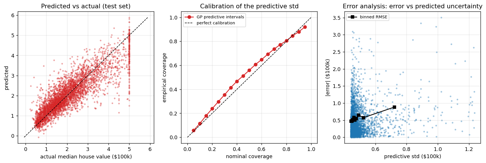

From the 300 rows in `artifacts/sample_predictions.csv`:

- Mean absolute error 0.411, median 0.299. 90.0 % of true values fall inside the 95 % interval, so the
  intervals are slightly too narrow on this sample. The full test set gives 92.1 %.
- **Capped targets.** 12 sample rows have the dataset's cap value (5.00001). Their mean absolute
  error is 0.666, against 0.401 for the other rows. The GP cannot learn the cap: in the scatter plot,
  the vertical band at 5.0 shows predictions anywhere from about 1.5 to 5.9.
- **By income.** The error grows with median income. The mean absolute error is 0.322 in the
  lowest-income quartile and 0.485 in the highest. Coverage falls from 94.7 % to 86.7 %, while the
  predicted std barely changes (0.51 to 0.48). Expensive areas are therefore more uncertain than the
  model reports.
- **Uncertainty vs error.** Splitting the sample by predicted std into tertiles gives a mean absolute
  error of 0.428, 0.376 and 0.430. The stationary RBF predictive std is a weak signal for which rows
  are hard: the middle panel shows calibration is reasonable overall, but the right panel shows
  large errors at the smallest std.
- The largest error (row 12430, MedInc 10.29) has a true value of 3.82 and a prediction of 2.06. It
  has the highest std in the sample (1.21) and lies inside its interval. This is the ideal behaviour
  for an out-of-distribution input.

## 7. Extra experiment: entropy of Gaussian mixtures

50 random 1-D mixtures, compared with dense-quadrature ground truth:

| Method | Mean frac. error | Median frac. error | Max frac. error | Converged |
|---|---|---|---|---|
| MEMe, m = 30 | **0.00016** | 0.000038 | 0.0019 | 84 % |
| MEMe, m = 10 | 0.0052 | 0.0024 | 0.043 | 76 % |
| Monte Carlo, 100 samples | 0.040 | 0.031 | 0.130 | - |
| Single-Gaussian moment matching | 0.134 | 0.087 | 0.837 | - |

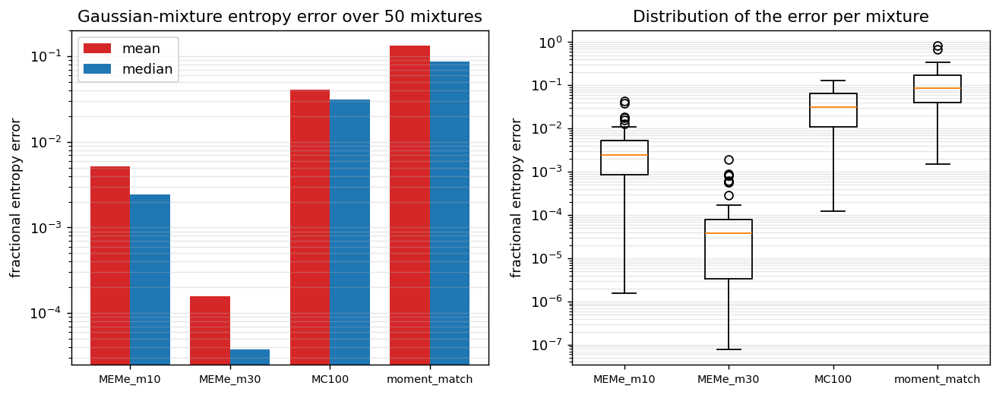

*Interpretation.* With noiseless (analytic) moments, MEMe is extremely accurate. At m = 30 its mean
error is about 250 times lower than Monte Carlo with 100 samples. This matches the direction of the
paper's FITBO claim. Even here, 16 % of the m = 30 solves did not meet the strict 1e-8 tolerance, yet
the entropy estimates stayed accurate.

## 8. Other figures

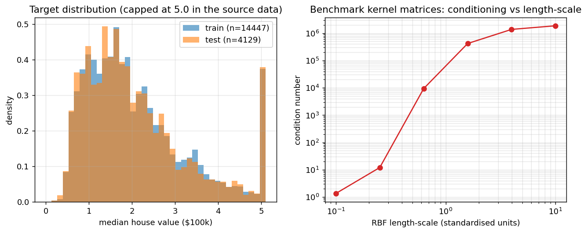

*Data overview.* The target distribution has a cap spike at 5.0, and the train and test histograms
match. The condition number of the benchmark kernel grows from 1.36 to 1.87e6 as the length-scale
increases, which gives us the well-to-ill-conditioned sweep.

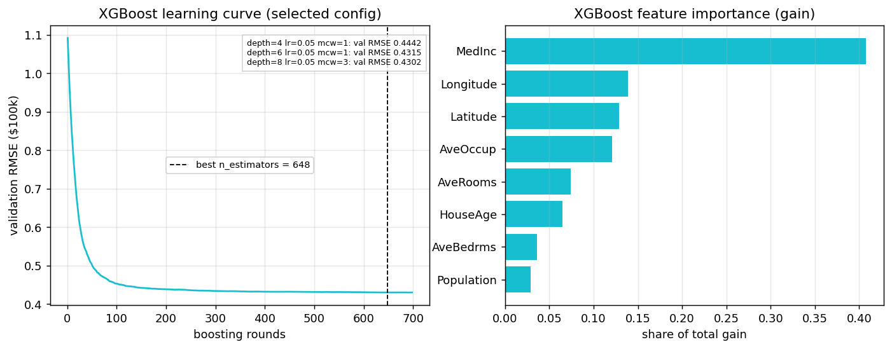

*XGBoost.* This shows the validation search and gain importance for the extra predictive baseline.
MedInc carries 40.7 % of the gain, followed by Longitude (13.9 %), Latitude (12.9 %) and AveOccup
(12.1 %).

**Service.** The served model (`artifacts/model.joblib`, 0.110 MB) answers a single-row prediction in
0.68 ms at the median and 1.20 ms at p95. This was measured in-process over 200 calls, with no HTTP
overhead.

## 9. Honest comparison with the source paper

| Paper's claim | What we observe | Same setup? |
|---|---|---|
| MEMe beats Chebyshev or Taylor polynomial approximations of log-det | **Confirmed**: 0.149 vs 0.503 median relative error at equal budget, winning 83.3 % of cases | Different: real-data RBF kernels, n = 2000, d = 30, 3 seeds. The paper used a synthetic n = 1000 kernel. |
| MEMe beats Lanczos (SLQ) especially on ill-conditioned matrices | **Not reproduced.** SLQ is better in 83.3 % of cases and far better on the ill-conditioned matrices (for example 0.00092 vs 0.247 at cond 1.87e6) | Different: our largest condition number is 1.87e6, while the paper reports about 4e9. Our SLQ uses full block Lanczos, and our MEMe uses our own quadrature grid. |
| Orthogonal moments let MaxEnt use many moments, while power moments break down | **Confirmed**: MEMe's error falls steadily up to m = 100, while power MaxEnt stays flat at about 0.40 and converges in only 16.7 % of solves at m = 100 | We tested up to m = 100, not "hundreds" |
| The Newton solve is robust | **Only with a modification.** With noisy Hutchinson moments and hard constraints, 0 % of solves converged at m >= 30. Soft (noise-aware) constraints gave 100 % convergence. | Same algorithmic family. The soft constraint is our addition. |
| MEMe estimates Gaussian-mixture entropy accurately (for FITBO) | **Confirmed in 1-D**: mean fractional error 0.00016 at m = 30 vs 0.040 for MC-100 | We test only entropy accuracy, not the full Bayesian-optimisation benchmarks |
| (Not tested in the paper) a better log-det gives better downstream GP selection | MEMe chooses the same hyper-parameters as exact (test RMSE 0.567). Chebyshev does not (0.663). | New experiment |

We do not reuse any numbers from the paper. The paper's own figures are quoted only in
`docs/01_literature_survey.md` for context.

## 10. Limitations

- **Small matrices.** At n = 2000 with dense products, exact Cholesky is faster than every
  approximation. We demonstrate the accuracy trade-off, not a speed-up.
- **Moderate conditioning.** The maximum condition number is 1.87e6, so the regime where the paper
  reports MEMe beating Lanczos (about 1e9) is not covered.
- **Few seeds.** 3 probe seeds and 6 matrices give 18 cases per (method, m). The medians are
  indicative, and we report no confidence intervals.
- **Relative error near zero.** For ell = 0.1 the exact log-det is 1.94, which inflates relative
  errors.
- **The main MEMe model is a modified variant** (soft constraints). The paper's hard-constraint
  version was slightly more accurate but almost never converged.
- **The downstream GP** uses a 2000-row subset with exact inference and a coarse 8 x 6 grid. It is
  outperformed by XGBoost.
- **The latency figure** excludes HTTP overhead.

## 11. Future work

- Test sparse matrices with n of 1e5 or more (for example SuiteSparse or graph Laplacians), where
  stochastic estimators should beat Cholesky in wall time.
- Push the condition number to 1e8 or above (smaller noise, larger length-scales) to test the paper's
  regime directly.
- Try adaptive or spectrum-aware quadrature, or a mixed MaxEnt with a point mass at `lambda_min`, to
  resolve the spike at the noise floor that dominates MEMe's error.
- Combine SLQ nodes with MaxEnt smoothing, and compare at equal *wall time* as well as equal
  matrix-vector budget.
- Use gradient-based GP hyper-parameter optimisation with stochastic log-det gradients instead of a
  grid.
- Run more probe seeds and report bootstrap confidence intervals.
