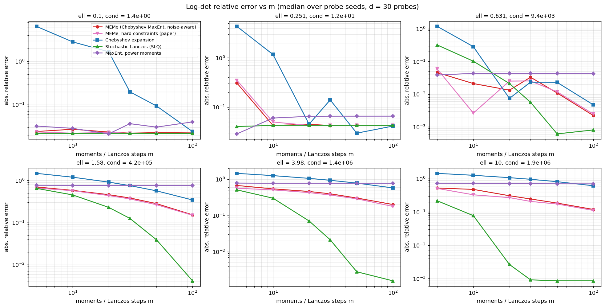
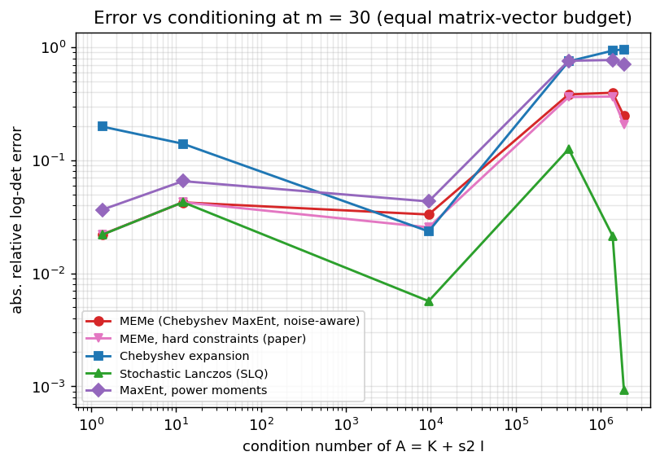
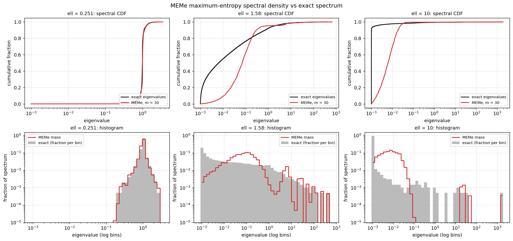
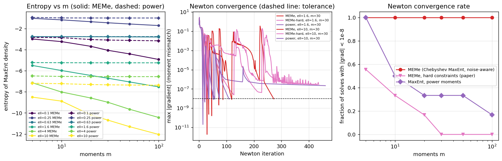
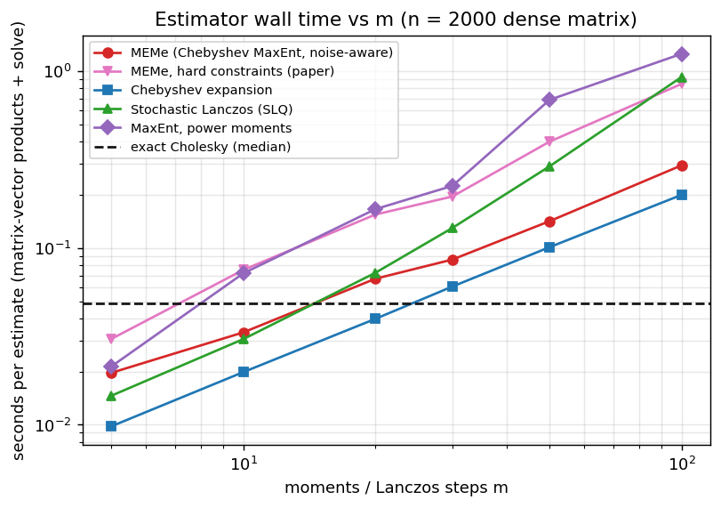
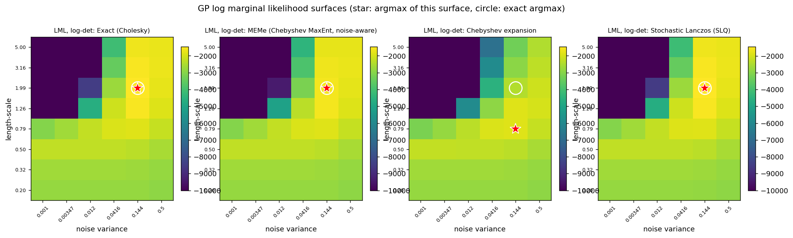
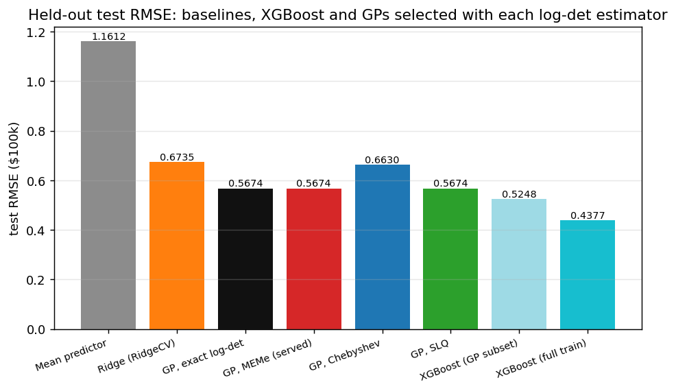
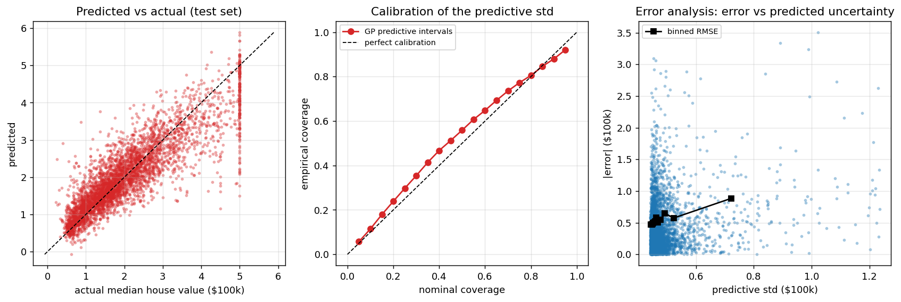
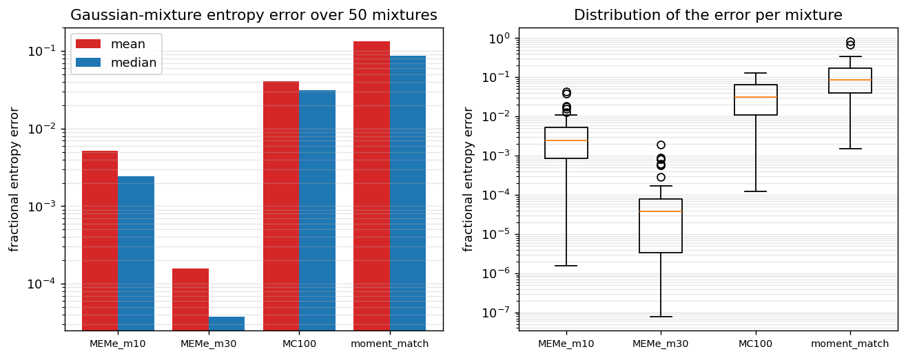

# Maximum-Entropy Spectral Log-Determinants in Practice: A Reproduction and Downstream Evaluation of MEMe for Gaussian-Process Model Selection

*Reproduction study, 2026*

## Abstract

Log-determinants of large positive-definite matrices are central to Gaussian-process (GP) marginal
likelihoods, but computing them exactly costs time cubic in n. MEMe estimates the log-determinant
from the maximum-entropy spectral density consistent with stochastic Chebyshev moments. We
re-implement it and evaluate it on RBF kernel matrices (n = 2000) built from the California Housing
dataset. The matrices cover six length-scales, with condition numbers from 1.36 to 1.87e6. Every
estimator gets the same budget of m moments (or Lanczos steps) with d = 30 probes. At m = 30, MEMe
reaches a median absolute relative error of 0.149. The stochastic Chebyshev expansion baseline
reaches 0.503, so MEMe is 3.4 times lower and wins 83.3 % of cases. Its error keeps falling as m
grows (0.085 at m = 100), while power-moment MaxEnt stays at about 0.40. Stochastic Lanczos
quadrature, however, is far more accurate in our setting (0.021). We find that the paper's
hard-constraint Newton solve fails to converge on noisy Hutchinson moments: 0 % of solves converge
at m >= 30. A soft-constraint, noise-aware variant converges in 100 % of solves at similar accuracy.
In a downstream test, GP hyper-parameters chosen with the MEMe log-determinant are identical to
those chosen with the exact one (test RMSE 0.567). Those chosen with the Chebyshev expansion give
test RMSE 0.663. For 1-D Gaussian-mixture entropy, MEMe at m = 30 has a mean fractional error of
0.00016, against 0.040 for 100-sample Monte Carlo. All code, metrics and an interactive dashboard
are released.

**Index Terms** - maximum entropy, log-determinant, spectral density estimation, stochastic trace
estimation, Gaussian processes, Chebyshev moments, Lanczos quadrature, model selection.

## I. Introduction

Many large-scale learning problems need the log-determinant of a symmetric positive-definite matrix.
The GP log marginal likelihood, used to select kernel hyper-parameters, is the canonical example
[6], [7]. Cholesky factorisation gives the exact value in O(n^3) time. Stochastic methods instead
estimate `log det A = tr log A` from matrix-vector products alone. They combine Hutchinson's trace
estimator [2] with a polynomial approximation of the logarithm [3], with Gauss quadrature from
Lanczos [4], or with a reconstructed spectral density [5], [8].

Granziol et al. [1] propose MEMe. It is a maximum-entropy (MaxEnt) method that recovers the
spectral density from Chebyshev moments and solves the convex dual with Newton's method. They argue
that orthogonal moments make it robust at large moment counts, that the result is equivalent to
constrained variational inference, and that it beats polynomial and Lanczos approximations,
especially on ill-conditioned matrices. They also apply it to Gaussian-mixture entropy in Bayesian
optimisation [10].

This report makes four contributions:
1. An open re-implementation of MEMe, compared at equal matrix-vector budgets with the stochastic
   Chebyshev expansion [3], stochastic Lanczos quadrature (SLQ) [4] and power-moment MaxEnt [5].
   The matrices are real-data kernels spanning six orders of magnitude in conditioning.
2. A test of the moment-count claim up to m = 100.
3. Evidence that hard moment constraints fail to converge on noisy stochastic moments, together with
   a noise-aware soft-constraint variant that always converges.
4. A downstream test of whether log-det accuracy matters for GP hyper-parameter selection.

## II. Related Work

**Stochastic trace estimation.** Hutchinson [2] introduced the unbiased estimator
`tr(A) ~ mean(z^T A z)` with Rademacher probes. It underlies every method studied here. It provides
traces, but not `tr f(A)` directly.

**Polynomial expansions.** Han et al. [3] expand `log(x)` in Chebyshev polynomials and estimate each
term with Hutchinson probes. This gives a linear-time log-det for large sparse matrices. The
polynomial fit degrades when eigenvalues approach zero.

**Lanczos quadrature.** Ubaru et al. [4] run Lanczos from each probe vector and apply Gauss quadrature
to the resulting tridiagonal matrix (SLQ). They report faster convergence than Chebyshev expansions.
Dong et al. [6] compare Chebyshev, Lanczos and surrogate estimators for GP kernel learning and find
that Lanczos generally works better. GPyTorch [7] builds Lanczos log-det terms into batched
conjugate-gradient GP inference.

**Spectral density and maximum entropy.** Lin et al. [8] survey kernel-polynomial and Lanczos
density-of-states methods. They note that smoothed polynomial densities can become negative or
oscillate. Fitzsimons et al. [5] fit a MaxEnt density to stochastic *power* moments. Power moments
are badly conditioned, which limits how many can be used. Bandyopadhyay et al. [9] give an iterative
dual MaxEnt solver (OMxnt), which [1] reports to be unstable beyond a few moments. MEMe [1] replaces
power moments with Chebyshev moments and uses a Newton solver with an analytic Hessian.

**Mixture entropy.** FITBO [10] needs the entropy of a Gaussian mixture, which has no closed form.
MEMe was proposed as an accurate approximation for it [1].

## III. Methodology

### A. Spectral scaling and Chebyshev moments

Let `A = K + s^2 I`, where `K` is an RBF kernel matrix with unit signal variance. The spectrum lies in
`[lambda_l, lambda_u]`, with `lambda_l = s^2` (since `K` is PSD) and `lambda_u` the Gershgorin bound
(maximum absolute row sum). The affine map `B = (2A - (lambda_u + lambda_l) I) / (lambda_u - lambda_l)`
places the spectrum in [-1, 1]. With d Rademacher probes `z_i`, the moments
`mu_k = (1/n) tr T_k(B) ~ (1/(n d)) sum_i z_i^T T_k(B) z_i`, for k = 0..m, come from the three-term
recurrence `T_{k+1}(B) z = 2 B T_k(B) z - T_{k-1}(B) z`. This costs m block matrix-vector products.
We also record the standard error `s_k` of each moment across the probes.

### B. Maximum-entropy density

MEMe seeks `p(x) = exp(-sum_k alpha_k T_k(x))` on [-1, 1] that matches the moments. The multipliers
minimise the convex dual

`L(alpha) = integral exp(-sum_k alpha_k T_k(x)) dx + sum_k alpha_k mu_k`.

Its gradient is `mu_k - E_p[T_k]` and its Hessian is the moment covariance under `p`. We use damped
Newton steps with a backtracking line search and 1e-8 Hessian jitter, as in [1]. Integrals use a
graded quadrature grid of about 4000 nodes, refined toward -1, where `log` is steep. The solve stops
when the gradient max-norm falls below 1e-8, or after at most 200 iterations.

### C. Noise-aware (soft-constraint) variant

Hutchinson moments are noisy. A noisy moment vector is often not realisable by any positive density,
and then the hard-constrained dual has no finite minimiser. We therefore add
`0.5 * sum_{k>=1} s_k^2 alpha_k^2` to the dual. This is equivalent to Gaussian noise on each moment
constraint, or a Gaussian prior on the multipliers, which fits the variational-inference view of
[1]. The dual becomes strongly convex. This variant is our main model ("MEMe"). The original
hard-constraint version is kept as the ablation "MEMe (hard)".

### D. Log-determinant read-out

Mapping `x` back to `lambda(x)`, the estimate is `log det A = n * E_p[log lambda(x)]`.

### E. Baselines

1. The stochastic Chebyshev expansion of `log` [3], using the same moments. This is the primary
   baseline.
2. SLQ [4] with m Lanczos steps per probe, on the same probes.
3. MaxEnt with power moments [5].
4. Exact Cholesky as ground truth.

### F. Downstream GP selection

For each (ell, s^2) on a grid, the GP log marginal likelihood
`-0.5 y^T A^-1 y - 0.5 log det A - (n/2) log 2 pi` is evaluated with an exact data-fit term and the
log-det from each estimator. Each estimator selects the argmax, and an exact GP with those
hyper-parameters is evaluated on held-out data.

## IV. Experimental Setup

**Data.** California Housing (20,640 rows, 8 numeric features, target = median house value in
$100k), loaded through scikit-learn. We apply `log1p` to skewed features, standardise with
training-set statistics, and split 14,447 / 2,064 / 4,129 (train/validation/test) with seed 42.

**Log-det benchmark.** We use a fixed 2000-row training subset and RBF kernels at 6 length-scales,
log-spaced over [0.1, 10], with s^2 = 1e-3. The condition numbers are 1.36, 12.1, 9.40e3, 4.18e5,
1.38e6 and 1.87e6. We sweep m in {5, 10, 20, 30, 50, 100} with d = 30 probes over 3 seeds; all
methods share the probes in each seed. The metric is `|est - exact| / |exact|`. The primary metric
is its median over the 18 (matrix, seed) cases at m = 30.

**GP selection.** We use a separate 2000-row training subset and an 8 x 6 grid with ell in [0.2, 5]
and s^2 in [1e-3, 0.5], with m = d = 30. The comparison models are a mean predictor, RidgeCV, and
XGBoost tuned on the validation split. XGBoost is trained once on the same 2000-row subset and once
on the full training set.

**GMM entropy.** 50 random 1-D Gaussian mixtures, with exact Chebyshev moments, MEMe at m = 10 and
m = 30, 100-sample Monte Carlo, and single-Gaussian moment matching. Dense quadrature gives the
ground truth.

**Hardware.** A CPU-only Windows laptop. The full pipeline ran in 141.7 s.

## V. Results

### A. Log-determinant accuracy

**TABLE I.** Log-det error at m = 30, d = 30 (18 cases)

| Method | Median rel. err | Mean rel. err | Max rel. err | Median time (s) |
|---|---|---|---|---|
| MEMe (noise-aware) | **0.149** | 0.186 | 0.398 | 0.088 |
| Chebyshev expansion [3] | 0.503 | 0.501 | 0.961 | 0.062 |
| MEMe (hard constraints) [1] | 0.130 | 0.171 | 0.368 | 0.205 |
| MaxEnt, power moments [5] | 0.406 | 0.398 | 0.772 | 0.240 |
| SLQ [4] | 0.021 | 0.036 | 0.126 | 0.127 |
| Exact Cholesky | 0 | 0 | 0 | 0.050 |

MEMe beats the Chebyshev expansion in 83.3 % of cases and power MaxEnt in 88.9 % of cases. It beats
SLQ in 16.7 % of cases.

**TABLE II.** Median relative error vs number of moments m

| m | MEMe | MEMe (hard) | Chebyshev | MaxEnt power | SLQ |
|---|---|---|---|---|---|
| 5 | 0.411 | 0.429 | 1.457 | 0.394 | 0.270 |
| 10 | 0.255 | 0.193 | 1.239 | 0.410 | 0.090 |
| 20 | 0.180 | 0.161 | 0.982 | 0.408 | 0.035 |
| 30 | 0.149 | 0.130 | 0.503 | 0.406 | 0.021 |
| 50 | 0.118 | 0.112 | 0.333 | 0.405 | 0.0094 |
| 100 | 0.085 | 0.081 | 0.196 | 0.404 | 0.0031 |

*Fig. 1.* Relative error vs m for each matrix. MEMe keeps improving with m; power MaxEnt plateaus.

**TABLE III.** Relative error at m = 30 vs conditioning

| ell | cond | MEMe | Chebyshev | MaxEnt power | SLQ |
|---|---|---|---|---|---|
| 0.1 | 1.36 | 0.022 | 0.199 | 0.036 | 0.022 |
| 0.251 | 12.1 | 0.042 | 0.140 | 0.065 | 0.043 |
| 0.631 | 9.40e3 | 0.033 | 0.023 | 0.043 | 0.0057 |
| 1.58 | 4.18e5 | 0.383 | 0.751 | 0.760 | 0.126 |
| 3.98 | 1.38e6 | 0.396 | 0.934 | 0.772 | 0.021 |
| 10 | 1.87e6 | 0.247 | 0.961 | 0.707 | 0.00092 |

*Fig. 2.* Error vs condition number. Above 1e5, MEMe degrades far less than Chebyshev and power
MaxEnt, but much more than SLQ.

*Fig. 3.* MEMe density vs the exact spectrum. On ill-conditioned matrices, the spike of eigenvalues
at the noise floor is smoothed out, which biases `E[log lambda]` upward.

### B. Solver stability

**TABLE IV.** Fraction of Newton solves converged (gradient < 1e-8)

| m | 5 | 10 | 20 | 30 | 50 | 100 |
|---|---|---|---|---|---|---|
| MEMe (noise-aware) | 1.00 | 1.00 | 1.00 | 1.00 | 1.00 | 1.00 |
| MEMe (hard) | 0.56 | 0.33 | 0.17 | 0.00 | 0.00 | 0.00 |
| MaxEnt power | 1.00 | 0.50 | 0.33 | 0.33 | 0.33 | 0.17 |

*Fig. 4.* Entropy vs m, Newton gradient traces, and convergence rates.

*Fig. 5.* Wall time per estimate. At n = 2000 with dense products, exact Cholesky (0.050 s) is
faster than all stochastic estimators from about m = 20.

### C. Downstream GP selection

MEMe and SLQ both select (ell, s^2) = (1.993, 0.144), the same as the exact log-det. The Chebyshev
expansion selects (0.795, 0.144). Over the 48 grid points, the median relative log-det error is
0.052 for MEMe, 0.013 for SLQ and 0.347 for Chebyshev.

**TABLE V.** Test-set regression metrics (4,129 rows)

| Model | RMSE | MAE | R^2 | NLL | 95 % cov. |
|---|---|---|---|---|---|
| GP, MEMe-selected | 0.567 | 0.397 | 0.761 | 0.836 | 0.921 |
| GP, exact-selected | 0.567 | 0.397 | 0.761 | 0.836 | 0.921 |
| GP, SLQ-selected | 0.567 | 0.397 | 0.761 | 0.836 | 0.921 |
| GP, Chebyshev-selected | 0.663 | 0.466 | 0.674 | 0.963 | 0.961 |
| Ridge | 0.674 | 0.488 | 0.663 | 1.024 | 0.943 |
| Mean predictor | 1.161 | 0.917 | -0.0003 | 1.568 | 0.928 |
| XGBoost (2000-row subset) | 0.525 | 0.358 | 0.796 | 0.775 | 0.940 |
| XGBoost (full train) | 0.438 | 0.284 | 0.858 | 0.593 | 0.942 |

*Fig. 6.* LML surfaces with each log-det. The star marks each surface's argmax; the circle marks the
exact argmax.

*Fig. 7.* Test RMSE of all predictors.

*Fig. 8.* The served GP: predicted vs actual values, interval calibration, and error vs predicted
std.

### D. Gaussian-mixture entropy

**TABLE VI.** Fractional entropy error over 50 mixtures

| Method | Mean | Median | Max |
|---|---|---|---|
| MEMe, m = 30 | 0.00016 | 0.000038 | 0.0019 |
| MEMe, m = 10 | 0.0052 | 0.0024 | 0.043 |
| Monte Carlo, 100 samples | 0.040 | 0.031 | 0.130 |
| Moment matching | 0.134 | 0.087 | 0.837 |

*Fig. 9.* Fractional entropy error by method.

## VI. Discussion and Limitations

**What reproduces.** Three of the paper's findings reproduce. Chebyshev-moment MaxEnt is markedly
more accurate than the Chebyshev polynomial expansion at an equal budget (Table I). Unlike
power-moment MaxEnt, it keeps improving as moments are added (Table II). It also estimates mixture
entropy very accurately (Table VI). The downstream experiment adds a practical point: MEMe's
log-det errors are small enough that the GP selects the same hyper-parameters as the exact
computation. The Chebyshev expansion's errors are not, and they cost 17 % in test RMSE.

**What does not reproduce.** SLQ beats MEMe in 83.3 % of cases. Its advantage is largest on the most
ill-conditioned matrices, the regime where [1] reports MEMe beating Lanczos. Fig. 3 shows why: when
most eigenvalues sit in a spike at the noise floor, a smooth MaxEnt density with 30 moments spreads
this mass out, while Gauss quadrature nodes can sit on it. Our setup differs from [1] in several
ways. Our condition numbers reach 1.87e6, against about 4e9 in [1]. Our matrices are real-data
kernels at n = 2000, not a synthetic n = 1000 kernel. Our SLQ is a full block-Lanczos
implementation. The quadrature and solver details are also our own. The comparison is therefore
not a direct refutation of [1].

**Robustness.** The hard-constraint Newton solve converged in none of the solves at m >= 30. Noisy
Hutchinson moments are typically not realisable by a positive density. The soft-constraint variant
fixes this, with 100 % convergence and less than half the median time (0.088 s vs 0.205 s). Its accuracy cost is small (0.149 vs
0.130 median), but real.

**Limitations.**
1. At n = 2000 with dense products, Cholesky is faster than every stochastic estimator, so we show
   accuracy, not speed-ups.
2. There are only 6 matrices and 3 seeds per configuration, and no confidence intervals.
3. Relative error is inflated where the exact log-det is near zero (ell = 0.1).
4. The GP uses a 2000-row subset and a coarse grid, and XGBoost outperforms it as a predictor.
5. The served GP's intervals are slightly narrow: 92.1 % coverage at the 95 % level, and lower for
   high-income areas.

## VII. Conclusion

We re-implemented MEMe and evaluated it at equal matrix-vector budgets on real-data kernel matrices.
It cuts the median log-det error of the stochastic Chebyshev expansion from 0.503 to 0.149 at
m = 30. It uses up to 100 moments productively, and it selects the same GP hyper-parameters as the
exact log-det. A noise-aware soft-constraint dual is needed for reliable convergence with stochastic
moments. In our moderate-conditioning, small-n setting, stochastic Lanczos quadrature remains the
more accurate estimator. Future work should test sparse matrices with n of 1e5 or more and condition
numbers of 1e8 or more, and MaxEnt variants with an explicit point mass at the lower spectral bound.

## References

[1] D. Granziol, B. Ru, S. Zohren, X. Dong, M. Osborne, and S. Roberts, "MEMe: An accurate maximum
entropy method for efficient approximations in large-scale machine learning," *Entropy*, vol. 21,
no. 6, p. 551, 2019; arXiv:1906.01101.

[2] M. F. Hutchinson, "A stochastic estimator of the trace of the influence matrix for Laplacian
smoothing splines," *Communications in Statistics - Simulation and Computation*, vol. 19, no. 2,
1990, doi:10.1080/03610919008812866.

[3] I. Han, D. Malioutov, and J. Shin, "Large-scale log-determinant computation through stochastic
Chebyshev expansions," in *Proc. Int. Conf. Machine Learning (ICML)*, 2015; arXiv:1503.06394.

[4] S. Ubaru, J. Chen, and Y. Saad, "Fast estimation of tr(f(A)) via stochastic Lanczos quadrature,"
*SIAM J. Matrix Analysis and Applications*, vol. 38, no. 4, 2017.

[5] J. Fitzsimons, D. Granziol, K. Cutajar, M. Osborne, M. Filippone, and S. Roberts, "Entropic trace
estimates for log determinants," in *Proc. ECML-PKDD*, 2017; arXiv:1704.07223.

[6] K. Dong, D. Eriksson, H. Nickisch, D. Bindel, and A. G. Wilson, "Scalable log determinants for
Gaussian process kernel learning," in *Advances in Neural Information Processing Systems (NeurIPS)*,
2017; arXiv:1711.03481.

[7] J. R. Gardner, G. Pleiss, D. Bindel, K. Q. Weinberger, and A. G. Wilson, "GPyTorch: Blackbox
matrix-matrix Gaussian process inference with GPU acceleration," in *Advances in Neural Information
Processing Systems (NeurIPS)*, 2018; arXiv:1809.11165.

[8] L. Lin, Y. Saad, and C. Yang, "Approximating spectral densities of large matrices," *SIAM
Review*, vol. 58, no. 1, 2016; arXiv:1308.5467.

[9] K. Bandyopadhyay, A. K. Bhattacharya, P. Biswas, and D. A. Drabold, "Maximum entropy and the
problem of moments: A stable algorithm," arXiv:cond-mat/0412717, 2005.

[10] B. Ru, M. McLeod, D. Granziol, and M. A. Osborne, "Fast information-theoretic Bayesian
optimisation," in *Proc. Int. Conf. Machine Learning (ICML)*, 2018; arXiv:1711.00673.
